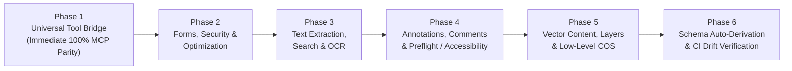

# PdfCraft SDK & REST Feature Parity Roadmap

This roadmap defines the implementation plan to bring the **PdfCraft Document Processing SDK** (`pdfcraft-sdk`, Python, TypeScript) and **REST Service** (`pdfcraft-rest`) to full feature parity with the ~149 headless tools exposed by `pdfcraft-automation` (and consumed by the MCP server).

All proposed domains, types, and methods strictly align with the canonical [**SDK API Reference Manual**](api-reference.md) (APDFL domain architecture) and Layer 7 isolation boundaries.

---

## 1. Executive Summary & Strategy

Currently, `pdfcraft-sdk` and `pdfcraft-rest` provide high-level execution for 3 core operations:
* `merge` (`POST /v1/merged-pdf`)
* `split` (`POST /v1/split-pdf`)
* `render_page` (`POST /v1/page-preview`)

While data types exist across 15 domains in `crates/sdk/src/lib.rs`, the underlying execution wiring currently uses only ~3 of the 149 tools available in `pdfcraft-automation`.

### Strategic Rationale: Token Economics & Determinism
- **Zero LLM Token / Credit Burn**: Calling document tools via an LLM agent consumes schema and prompt tokens on every turn. In contrast, the SDK and REST service execute in pure, compiled code with **zero AI token costs**, zero credit consumption, and zero third-party API rate limits.
- **100% Deterministic Execution**: Legal, archival, and financial document operations require absolute mathematical repeatability. Probabilistic LLMs can hallucinate parameters or drop fields; pure code execution guarantees identical, spec-conformant PDF object graphs every single run.
- **"AI Only Where Necessary"**: Most enterprise workflows (invoice generation, PDF watermarking, form filling, digital signing) do not require AI. Expanding the SDK and REST service gives developers the deterministic tools for 95% of tasks, allowing AI and MCP to be reserved exclusively for genuine cognitive workloads.

### Two-Track Expansion Strategy:
1. **Immediate Universal Parity (Phase 1 Escape Hatch)**:  
   Implement a generic tool execution method (`client.call_tool(tool_name, params)` / `POST /v1/operations/{tool_name}`) executing through `ExecutionSandbox`. This unlocks **100% of the 149 automation tools immediately** for SDK and REST consumers.
2. **Progressive Strongly-Typed Domain APIs (Phases 2–5)**:  
   Gradually graduate the highest-demand document workflows into strongly-typed methods, data classes, and dedicated REST routes across the 15 APDFL domains.

---

## 2. Phased Implementation Plan

---

### Phase 1: Universal Tool Execution Bridge (Immediate 100% Parity)
* **Goal**: Enable SDK and REST consumers to invoke any automation tool without waiting for dedicated typed wrappers.
* **Architecture**:
  * **SDK Port**: Add `call_tool(name: &str, params: serde_json::Value) -> Result<serde_json::Value, SdkError>` to `PdfCraftClient` and `OperationExecutor`.
  * **Engine Adapter**: Delegate through `ExecutionSandbox` to `pdfcraft_automation::Automation::call(&tool, &params)`.
  * **REST Route**: Expose `POST /v1/operations/{tool_name}` accepting a JSON payload and returning the structured tool output.
  * **Language Bindings**:
    * Rust: `client.call_tool("doc_watermark", json!({"doc": 1, "text": "CONFIDENTIAL"}))`
    * Python: `client.call_tool("doc_watermark", {"doc": 1, "text": "CONFIDENTIAL"})`
    * TypeScript: `await client.callTool("doc_watermark", { doc: 1, text: "CONFIDENTIAL" })`

---

### Phase 2: High-Volume Commercial Workflows (Forms, Security, Optimization)

#### Domain 10: Forms & Data Exchange (AcroForms & XFA)
* **MCP Tools Covered**: `form_fields`, `form_get`, `form_fill`, `form_reset`, `form_export_data`, `form_import_data`, `form_merge_data`, `form_detect`, `doc_flatten`, `xfa_to_static`.
* **SDK Methods (`PdfCraftClient`)**:
  * `get_form_fields(source: &DocumentSource) -> Result<Vec<FormField>, SdkError>`
  * `fill_form(source: &DocumentSource, data: &FormData, options: &FormFillOptions) -> Result<DocumentResult, SdkError>`
  * `export_form_data(source: &DocumentSource, format: DataFormat) -> Result<Vec<u8>, SdkError>`
  * `flatten_form(source: &DocumentSource) -> Result<DocumentResult, SdkError>`
* **REST Endpoints**:
  * `POST /v1/forms/inspect`
  * `POST /v1/forms/fill`
  * `POST /v1/forms/export`
  * `POST /v1/forms/flatten`

#### Domain 11: PDF Optimization & Compression
* **MCP Tools Covered**: `doc_optimize`, `doc_reduce`.
* **SDK Methods (`PdfCraftClient`)**:
  * `optimize_document(source: &DocumentSource, options: &OptimizationOptions) -> Result<DocumentResult, SdkError>`
  * `reduce_file_size(source: &DocumentSource, target: CompressionLevel) -> Result<DocumentResult, SdkError>`
* **REST Endpoints**:
  * `POST /v1/optimized-pdf`
  * `POST /v1/reduced-pdf`

#### Domain 12: Digital Signatures & Security
* **MCP Tools Covered**: `doc_encrypt`, `doc_decrypt`, `doc_permissions`, `doc_sanitize`, `redact_apply`, `sign_document`, `sign_verify`.
* **SDK Methods (`PdfCraftClient`)**:
  * `encrypt_document(source: &DocumentSource, options: &EncryptionOptions) -> Result<DocumentResult, SdkError>`
  * `decrypt_document(source: &DocumentSource, password: &str) -> Result<DocumentResult, SdkError>`
  * `apply_redactions(source: &DocumentSource, regions: &[RedactionRegion]) -> Result<DocumentResult, SdkError>`
  * `sign_document(source: &DocumentSource, credentials: &SigningCredentials, options: &SignOptions) -> Result<DocumentResult, SdkError>`
  * `verify_signatures(source: &DocumentSource) -> Result<Vec<SignatureValidation>, SdkError>`
* **REST Endpoints**:
  * `POST /v1/security/encrypt`
  * `POST /v1/security/decrypt`
  * `POST /v1/security/redact`
  * `POST /v1/security/sign`
  * `POST /v1/security/verify-signatures`

---

### Phase 3: Text, Content & OCR Pipelines

#### Domain 5: Text & Fonts
* **MCP Tools Covered**: `text_extract`, `text_find`, `text_word_count`, `text_paragraphs`, `text_edit`, `text_fonts`.
* **SDK Methods (`PdfCraftClient`)**:
  * `extract_text(source: &DocumentSource, options: &TextExtractOptions) -> Result<ExtractedText, SdkError>`
  * `search_text(source: &DocumentSource, query: &str) -> Result<Vec<TextSearchResult>, SdkError>`
  * `list_fonts(source: &DocumentSource) -> Result<Vec<FontDescriptor>, SdkError>`
* **REST Endpoints**:
  * `POST /v1/text/extract`
  * `POST /v1/text/search`

#### OCR & Export
* **MCP Tools Covered**: `ocr_recognize`, `ocr_recognize_files`, `doc_export_word`, `doc_export_html`, `doc_export_rtf`, `doc_export_text`, `doc_export_images`.
* **SDK Methods (`PdfCraftClient`)**:
  * `recognize_text_ocr(source: &DocumentSource, options: &OcrOptions) -> Result<DocumentResult, SdkError>`
  * `export_document(source: &DocumentSource, format: ExportFormat) -> Result<DocumentResult, SdkError>`
* **REST Endpoints**:
  * `POST /v1/ocr/recognize`
  * `POST /v1/convert/{format}`

---

### Phase 4: Annotations, Review, and Preflight

#### Domain 7: Annotations & Actions
* **MCP Tools Covered**: `comment_list`, `comment_add`, `comment_edit`, `comment_delete`, `comment_reply`, `comments_summarize`, `stamp_add`.
* **SDK Methods (`PdfCraftClient`)**:
  * `list_annotations(source: &DocumentSource, page: Option<usize>) -> Result<Vec<Annotation>, SdkError>`
  * `add_annotation(source: &DocumentSource, annotation: &Annotation) -> Result<DocumentResult, SdkError>`
  * `delete_annotation(source: &DocumentSource, annot_id: &str) -> Result<DocumentResult, SdkError>`
  * `summarize_comments(source: &DocumentSource) -> Result<CommentSummary, SdkError>`
* **REST Endpoints**:
  * `POST /v1/annotations/list`
  * `POST /v1/annotations/create`
  * `POST /v1/annotations/summarize`

#### Accessibility & Preflight
* **MCP Tools Covered**: `accessibility_check`, `accessibility_auto_tag`, `accessibility_reading_order`, `pdfa_verify`, `pdfa_convert`.
* **SDK Methods (`PdfCraftClient`)**:
  * `check_accessibility(source: &DocumentSource) -> Result<AccessibilityReport, SdkError>`
  * `verify_pdfa(source: &DocumentSource, conformance: PdfAStandard) -> Result<PreflightReport, SdkError>`
* **REST Endpoints**:
  * `POST /v1/preflight/accessibility`
  * `POST /v1/preflight/pdfa`

---

### Phase 5: Vector Content, Layers & Low-Level COS

#### Domain 8 & 9: Low-Level Objects (COS) & Optional Content (Layers / OCG)
* **MCP Tools Covered**: `object_list`, `object_move`, `layer_list`, `layer_visibility`, `bookmark_*`, `link_*`, `measure_*`.
* **SDK Methods (`PdfCraftClient`)**:
  * `list_layers(source: &DocumentSource) -> Result<Vec<OptionalContentGroup>, SdkError>`
  * `set_layer_visibility(source: &DocumentSource, layer_id: &str, visible: bool) -> Result<DocumentResult, SdkError>`
  * `inspect_cos_catalog(source: &DocumentSource) -> Result<CosObject, SdkError>`
* **REST Endpoints**:
  * `POST /v1/layers/inspect`
  * `POST /v1/layers/visibility`

---

### Phase 6: Automated Schema Generation & CI Conformance

1. **Auto-generate `openapi.json` from Rust Types**:
   - Derive `utoipa` or `schemars::JsonSchema` on all request/response models in `crates/rest` and `crates/sdk`.
   - Add a test in `crates/rest/tests/contract_tests.rs` asserting that `sdks/openapi.json` matches generated schemas.
2. **Promote `sdks/check_contract_drift.py` to `cargo xtask ci`**:
   - Register the drift check in `cargo xtask ci` so any mismatch in enum variants, method names, or serialized fields across Rust, Python, and TypeScript fails the pull request gate automatically.
